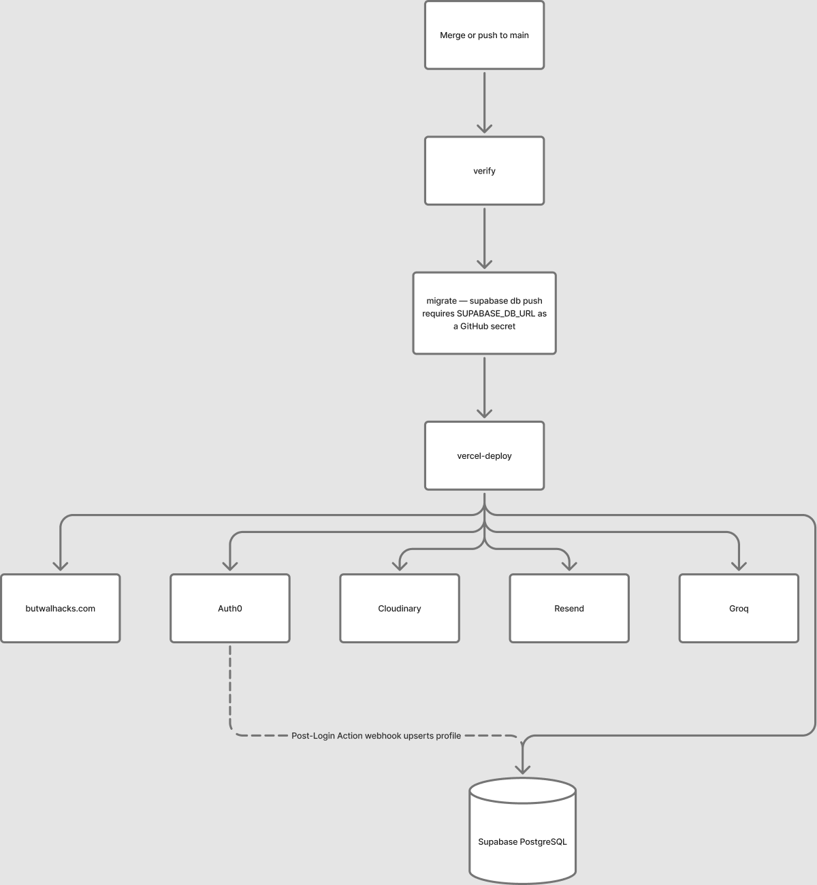

# Maintainer Handbook

> Deploy, rollback, environment variables, and incident notes. Assumes access to the Vercel project, the Auth0 tenant, the Supabase project, and the GitHub repository.

This is a **single-maintainer** handbook. There is no on-call rotation and no duty roster; if that changes, restore the full apparatus here. It documents what exists so the next maintainer can verify it — it does not describe a team that does not exist yet.

## Contents

- [What this is](#what-this-is)
- [Quick actions](#quick-actions)
- [Reference](#reference)
  - [Environment variables](#environment-variables)
  - [Deploy flow](#deploy-flow)
  - [Release checklist](#release-checklist)
  - [Rollback](#rollback)
  - [If something breaks in production](#if-something-breaks-in-production)
  - [What not to commit](#what-not-to-commit)
- [See also](#see-also)

## What this is

How the platform is operated in production: what runs, how to ship, how to roll back, and what to check when something breaks.

It is not an org chart and not an incident-command manual. Everything here is verified as of the commit that last touched this file; if something in it fails, fix the section rather than work around it.

## Quick actions

**Ship a change:**

```bash
# 1. Apply pending migrations
supabase db push --db-url "$SUPABASE_DB_URL"

# 2. Merge to main; Vercel deploys automatically
git push origin main

# 3. Verify
curl -s -o /dev/null -w '%{http_code}\n' https://butwalhacks.com/
```

**Rotate an exposed credential:** follow [docs/SECRET_ROTATION_RUNBOOK.md](docs/SECRET_ROTATION_RUNBOOK.md) end to end. Do not skip step 0.

**Add a new environment variable:** add it to `my-app/.env.example` (name, format, and purpose only — never the value) in the same PR as the code that uses it. Values are set in Vercel and GitHub secrets, not in this file.

## Reference

### Environment variables

Every name the app reads is listed in `my-app/.env.example`, grouped by `Required`, `Optional`, and `CI Only`. That file is the canonical inventory and ships with the repository, so it never drifts from the code the way a hand-maintained table does.

What the exemplar deliberately does not contain:

- **Where each value is configured** — Vercel project settings, GitHub repository secrets. If you have that access, you already know; if you do not, you do not need it to build against the example file.
- **Which values are live in production** — no list exists in this repository, and none should.

The subset that must be present for a deploy to succeed:

| Group | Variables (names only) |
|-------|------------------------|
| Auth0 | `AUTH0_SECRET`, `AUTH0_DOMAIN`, `AUTH0_CLIENT_ID`, `AUTH0_CLIENT_SECRET`, `AUTH0_BASE_URL`, `AUTH0_WEBHOOK_SECRET`, `AUTH0_M2M_CLIENT_ID`, `AUTH0_M2M_CLIENT_SECRET` |
| Supabase | `NEXT_PUBLIC_SUPABASE_URL`, `NEXT_PUBLIC_SUPABASE_ANON_KEY`, `SUPABASE_SERVICE_ROLE_KEY`, `SUPABASE_DB_URL` |
| Cloudinary | `NEXT_PUBLIC_CLOUDINARY_CLOUD_NAME`, `NEXT_PUBLIC_CLOUDINARY_UPLOAD_PRESET`, `CLOUDINARY_API_KEY`, `CLOUDINARY_API_SECRET` |

CI-only variables (e.g. `ANTHROPIC_API_KEY`, `GITHUB_TOKEN`) are documented alongside them in `my-app/.env.example`.

**Rotating one:** see [docs/SECRET_ROTATION_RUNBOOK.md](docs/SECRET_ROTATION_RUNBOOK.md). Rotate at the source first, then redeploy, then verify the feature that depends on it.

### Deploy flow



`.github/workflows/deploy.yml` runs three jobs in order on every push to `main`: verify (typecheck, lint, test), migrate, then deploy.

**Migration transport must be a direct or session-pooler `SUPABASE_DB_URL`.** A transaction-pooler URL cannot run DDL. A failed migrate job leaves the Vercel deploy green while the app hits schema errors on fresh deploys — check the deploy workflow logs whenever a route starts erroring after a deploy.

### Release checklist

**Before merge**

- [ ] `npm run typecheck` clean
- [ ] `npm run lint` clean
- [ ] `npm run test` passing
- [ ] `npm run build` succeeding
- [ ] New mutation routes wrapped in `withRateLimit()`
- [ ] New `POST` routes returning `{ status: 201 }` for resource creation
- [ ] New env vars added to `my-app/.env.example` in the same PR
- [ ] New migration numbered sequentially, additive, and applied in order
- [ ] `supabase db push` does not fail — read the migrate job log after merge
- [ ] No secrets in the diff

**After merge**

- [ ] Deploy workflow is green end to end, not just the Vercel job
- [ ] Homepage loads at `https://butwalhacks.com`
- [ ] Sign-in flow completes; at least one dashboard loads
- [ ] Sentry shows no new error cluster in the first five minutes
- [ ] PostHog session count looks normal for the time of day

### Rollback

#### Application

1. Vercel → Deployments → the last known-good deployment → Promote to Production.
2. Verify at `https://butwalhacks.com`.

#### Database

Migrations are additive by convention. To reverse one, write the inverse DDL and run it in the Supabase SQL editor:

```sql
DROP FUNCTION IF EXISTS get_next_task_position(UUID, TEXT);
```

#### Both

1. `git revert <commit>` and push to `main`.
2. Apply the database rollback SQL in the Supabase SQL editor.
3. Verify at `https://butwalhacks.com`.

### If something breaks in production

Single maintainer means one diagnosis path at a time; there is nobody else to page. Check, in order:

| Symptom | First move |
|---------|------------|
| Sign-in is broken | See below — it is almost always the Post-Login Action |
| Database errors in production | Read the SQL error in the Vercel function logs; check `pg_stat_activity` for pool exhaustion |
| Emails not sending | Check the Resend dashboard for errors/quota; the free tier is 100/day |
| Rate limiting appears disabled | Redis unreachable — the limiter fails open; check Upstash quota and `UPSTASH_REDIS_REST_URL` |
| CI failing | `npm run <the-checking-task>` locally; the PR gates exist to catch exactly this |

#### Sign-in broken

1. Check `https://status.auth0.com`.
2. Verify the Auth0 application's callback/logout URLs include `https://app.butwalhacks.com/auth/callback`.
3. Verify the Post-Login Action is enabled and built; without it, profiles are never created and new users loop.

### What not to commit

| Category | Examples |
|----------|----------|
| Build output | `.next/`, `out/` |
| Local logs | any `.log`, `dev_log.txt` |
| Rotated or leaked credentials | any file, however small |
| Per-developer AI tooling | `.opencode/`, `agent/`, `skills-lock.json`, `opencode.json` |
| Local staging | `.upload-staging/`, `upload-all-photos.sh`, `upload-photos.js` |
| Editor/OS files | `.vscode/`, `.idea/`, `.DS_Store` |

Add new patterns to `.gitignore` at the repo root.

## See also

- [AGENTS.md](AGENTS.md) — what a change must pass, and repo conventions
- [.github/CONTRIBUTING.md](.github/CONTRIBUTING.md) — how to ship a change
- [.github/SECURITY.md](.github/SECURITY.md) — vulnerability reporting
- [docs/SECRET_ROTATION_RUNBOOK.md](docs/SECRET_ROTATION_RUNBOOK.md) — rotating an exposed credential
- [docs/reports/2026-09-security-remediation.md](docs/reports/2026-10-security-remediation.md) — the P0/P1 authorization defects that were fixed
- [docs/ARCHITECTURE.md](docs/ARCHITECTURE.md) — engineering reference
