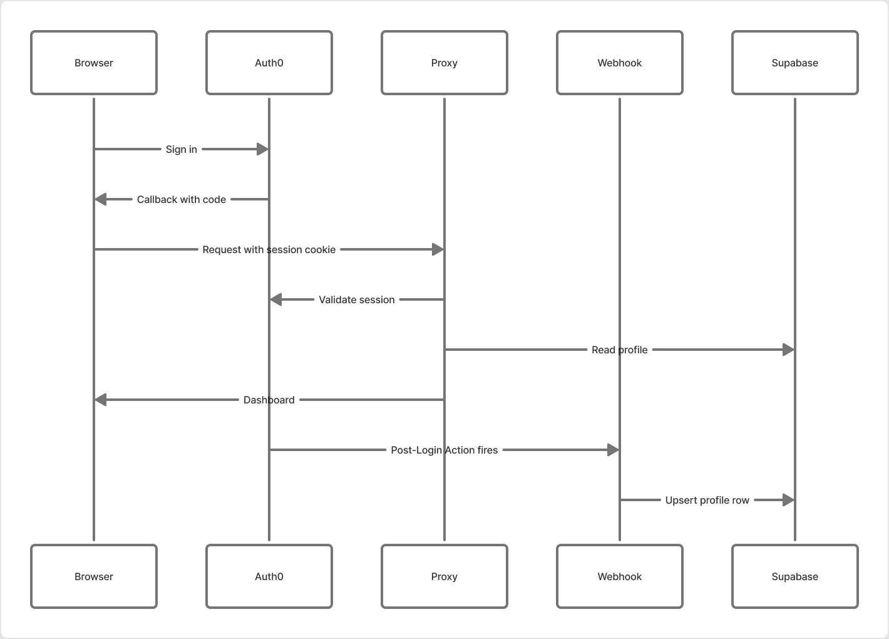

<p align="center">
  
</p>

<h1 align="center">Butwal Hacks</h1>

<p align="center">
  <a href="https://github.com/Prarambha369/Butwal-Hacks/actions/workflows/ci.yml/badge.svg"></a>
  <a href="https://github.com/Prarambha369/Butwal-Hacks/actions/workflows/deploy.yml/badge.svg"></a>
  <a href="LICENSE"></a>
  
  
  <a href="https://opencollective.com/butwal-hacks"></a>
</p>

<p align="center"><strong>Verified credentials and hackathon management for young builders in Nepal.</strong></p>

---

## Contents

- [What this is](#what-this-is)
- [Choose your path](#choose-your-path)
- [Requirements](#requirements)
- [Quick start](#quick-start)
- [Configuration](#configuration)
- [Architecture](#architecture)
- [Verification](#verification)
- [Reference](#reference)
  - [Tech stack](#tech-stack)
  - [By the numbers](#by-the-numbers)
  - [Repository layout](#repository-layout)
- [Troubleshooting](#troubleshooting)
- [See also](#see-also)
- [Credits](#credits)
- [License](#license)

## What this is

Butwal Hacks gives young builders in Nepal an ORCID-style public identity, a place to run hackathons, and a record of work they can prove. This repository holds the Next.js application, the database schema, and the automation around both.

The live platform runs at [butwalhacks.com](https://butwalhacks.com), with the application on [app.butwalhacks.com](https://app.butwalhacks.com).

## Choose your path

This repository serves several different audiences. Jump to the one that matches you.

| If you are | Start here | Then read |
|------------|-----------|-----------|
| A **new contributor** | [Quick start](#quick-start) below | [CONTRIBUTING.md](CONTRIBUTING.md) for the PR workflow, [AGENTS.md](AGENTS.md) for conventions |
| A **returning contributor** | [Verification](#verification) | [AGENTS.md](AGENTS.md#reference) for access control, API routes, and database rules |
| A **maintainer** | [MAINTAINERS.md](MAINTAINERS.md) | Secrets inventory, deploy and rollback runbook, on-call |
| Looking for **product context** | [PRODUCT.md](PRODUCT.md) | Mission, the nine route zones, roles, roadmap |
| A **designer or frontend dev** | [DESIGN.md](DESIGN.md) | The 58 `--bh-*` tokens and `bh-*` utility classes |
| **Reporting a vulnerability** | [SECURITY.md](SECURITY.md) | Private disclosure, never a public issue |
| **Looking for the legal terms** | [policies/README.md](policies/README.md) | Terms of service, privacy, guardian consent, safeguarding, event rules |
| A **sponsor or partner** | [PRODUCT.md](PRODUCT.md#product-identity) | How sponsorship and bounties work via Open Collective |

New to the codebase? Read [docs/ARCHITECTURE.md](docs/ARCHITECTURE.md) once. It explains the decisions that are expensive to reverse.

## Requirements

| Requirement | Version | Notes |
|-------------|---------|-------|
| Node.js | **20 or newer** | `my-app/package.json` enforces `>=20.0.0`; Vercel deploys on 22.x |
| Package manager | **npm only** | pnpm and yarn are not supported. The root `package.json` is an npm workspace |
| Git | any recent version | Pre-commit hooks run through `.husky/` |

You also need accounts for [Auth0](https://auth0.com), [Supabase](https://supabase.com), and [Cloudinary](https://cloudinary.com) before the app will start cleanly. Everything else degrades gracefully.

## Quick start

```bash
git clone https://github.com/Prarambha369/Butwal-Hacks.git
cd Butwal-Hacks
npm install
cp my-app/.env.example my-app/.env.local   # then fill in your keys
git config core.hooksPath .husky/          # enables pre-commit lint + secrets audit
npm run dev                                # → http://localhost:3000
```

Every script delegates from the repo root into `my-app/`, so `npm run lint` works from either directory.

`git config core.hooksPath .husky/` is also run automatically by `npm install` via the root `prepare` script. The explicit call above is only needed on a fresh clone that skipped install.

## Configuration

All configuration lives in `my-app/.env.local`. The template documents every variable inline, marked `Required` (the app breaks without it), `Optional` (the feature degrades gracefully), or `CI Only`.

```bash
cp my-app/.env.example my-app/.env.local
```

To generate a signing secret:

```bash
openssl rand -hex 32    # AUTH0_SECRET
```

The **16 required variables** are:

| Group | Variables |
|-------|-----------|
| Supabase | `NEXT_PUBLIC_SUPABASE_URL`, `NEXT_PUBLIC_SUPABASE_ANON_KEY`, `SUPABASE_SERVICE_ROLE_KEY` |
| Auth0 | `AUTH0_SECRET`, `AUTH0_DOMAIN`, `AUTH0_CLIENT_ID`, `AUTH0_CLIENT_SECRET`, `AUTH0_BASE_URL`, `AUTH0_WEBHOOK_SECRET`, `AUTH0_M2M_CLIENT_ID`, `AUTH0_M2M_CLIENT_SECRET` |
| Cloudinary | `NEXT_PUBLIC_CLOUDINARY_CLOUD_NAME`, `NEXT_PUBLIC_CLOUDINARY_UPLOAD_PRESET`, `CLOUDINARY_API_KEY`, `CLOUDINARY_API_SECRET` |

**One setup step is easy to miss.** The Auth0 Post-Login Action must be enabled. It syncs each new user into the Supabase `profiles` table. Without it, every new user loops after login because no profile row is ever created.

Where each variable is set in production is documented in the [MAINTAINERS.md secrets inventory](MAINTAINERS.md#secrets-inventory).

## Architecture


Auth0 owns identity. Supabase stores relational data through the Service Role Key, which bypasses RLS and is server-side only. Cloudinary handles media through pre-signed upload signatures. Every mutation route validates with Zod, checks the Auth0 session, and passes through Upstash rate limiting.

`my-app/src/proxy.ts` is the single entry point for both Auth0 session enforcement and subdomain routing.



The Post-Login Action is the single most common cause of a broken local setup. See [Configuration](#configuration) above.

## Verification

```bash
npm run typecheck
npm run lint
npm run test
npm run build
```

All four must pass before a PR is opened. See [AGENTS.md](AGENTS.md) for the full gate definitions.

## Reference

### Tech stack

| Layer | Technology |
|-------|-----------|
| Framework | Next.js 16 (App Router, Turbopack) |
| Language | TypeScript (strict) |
| Styling | Tailwind CSS v4 |
| Authentication | Auth0, Regular Web App, Post-Login Action syncs to Supabase |
| Database | Supabase PostgreSQL via Service Role Key; Supabase Auth is not used |
| Media | Cloudinary |
| Rate limiting | Upstash Redis |
| Email | Resend |
| Analytics | PostHog and Vercel Analytics |
| Error tracking | Sentry |
| Payments | Open Collective |
| AI | Groq (team matching, chatbot, certificate OCR) |
| Hosting | Vercel |

### By the numbers

Counts as of the commit that last touched this table.

| Measure | Count |
|---------|-------|
| API route files | 59 |
| API handlers | 66 |
| Pages and layouts | 109 |
| React components | 161 |
| Files in `src/lib` | 159 |
| Database migrations | 98 |
| Unit and integration test files | 114 |
| End-to-end specs | 6 |
| Tests | 1687 |
| Roles | 5 |
| Design tokens | 58 |

### Repository layout

```text
Butwal-Hacks/
  my-app/                 # Next.js application
    src/
      app/                # App Router pages and API routes
      components/         # React components
      hooks/              # Custom hooks
      lib/                # Business logic, server actions, types
      utils/supabase/     # Supabase client factories
      proxy.ts            # Auth and subdomain routing
    e2e/                  # Playwright E2E tests
  supabase/migrations/    # 98 SQL migrations, sequentially numbered
  scripts/                # Operational scripts
  docs/                   # Architecture, runbooks, audit, and diagrams
  .github/                # Workflows, issue templates, PR template
  vercel.json             # Deployment config and cron schedules
```

## Troubleshooting

| Symptom | Fix |
|---------|-----|
| `npm install` fails on Node 18 | Upgrade to Node 20 or newer; `engines` enforces it |
| Port 3000 already in use | `PORT=3001 npm run dev` |
| Auth0 redirect loop on login | Enable the Post-Login Action; it syncs the profile to Supabase |
| Empty dashboard after signing in | The webhook at `/api/webhooks/auth0` did not fire; check `AUTH0_WEBHOOK_SECRET` |
| Supabase queries return 401 in production only | A manual Vercel env drifted from the integration; see [MAINTAINERS.md](MAINTAINERS.md) |
| Deploy fails at the migration step | `SUPABASE_DB_URL` is a transaction-pooler URL and cannot run DDL; use a direct connection string |
| Rate limiting appears disabled | Redis is unreachable and the limiter fails open; check `UPSTASH_REDIS_REST_URL` and quota |
| Colors wrong in dark mode | A literal hex bypassed a design token; see [DESIGN.md](DESIGN.md) |
| Pre-commit hook does not run | `git config core.hooksPath .husky/` was never set |

## See also

| Document | Covers |
|----------|--------|
| [AGENTS.md](AGENTS.md) | Setup, verification gates, conventions, access control |
| [CONTRIBUTING.md](CONTRIBUTING.md) | Contributor workflow and local development |
| [PRODUCT.md](PRODUCT.md) | Mission, users, route zones, roadmap |
| [DESIGN.md](DESIGN.md) | Colors, typography, utility classes, accessibility |
| [docs/ARCHITECTURE.md](docs/ARCHITECTURE.md) | ADRs, security model, testing, error handling |
| [MAINTAINERS.md](MAINTAINERS.md) | Secrets, deploy, CI, rollback, on-call |
| [SECURITY.md](SECURITY.md) | Vulnerability reporting |
| [CODE_OF_CONDUCT.md](CODE_OF_CONDUCT.md) | Community standards |
| [policies/](policies/README.md) | Terms, privacy, guardian consent, safeguarding, legal-entity registration, and our open compliance gaps |
| [docs/SECRET_ROTATION_RUNBOOK.md](docs/SECRET_ROTATION_RUNBOOK.md) | Rotating an exposed credential, end to end |
| [docs/SEO_AEO_GEO_AUDIT.md](docs/SEO_AEO_GEO_AUDIT.md) | Search and AI-answer visibility audit |
| [my-app/.env.example](my-app/.env.example) | Every environment variable, annotated |
| [my-app/public/llms.txt](my-app/public/llms.txt) | Machine-readable site summary for AI crawlers |

## Credits

Built and maintained by the Butwal Hacks core team in Butwal, Nepal — a youth-led nonprofit running hackathons, mentorship, and open projects.

- **Contributors** — see the [full contributor graph](https://github.com/Prarambha369/Butwal-Hacks/graphs/contributors). Commits are authored by [@Prarambha369](https://github.com/Prarambha369).
- **Built with** — Next.js, TypeScript, Tailwind CSS, Auth0, Supabase, Cloudinary, Upstash Redis, Resend, Groq, PostHog, Sentry, Open Collective, Vitest, and Playwright.

## License

MIT. See [LICENSE](LICENSE).